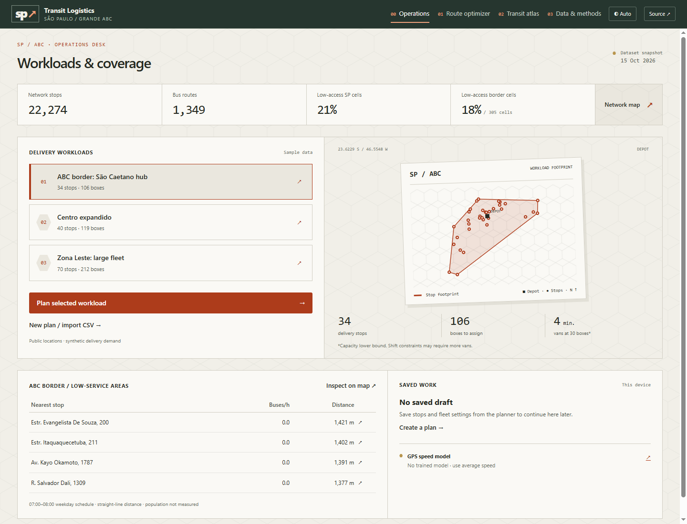
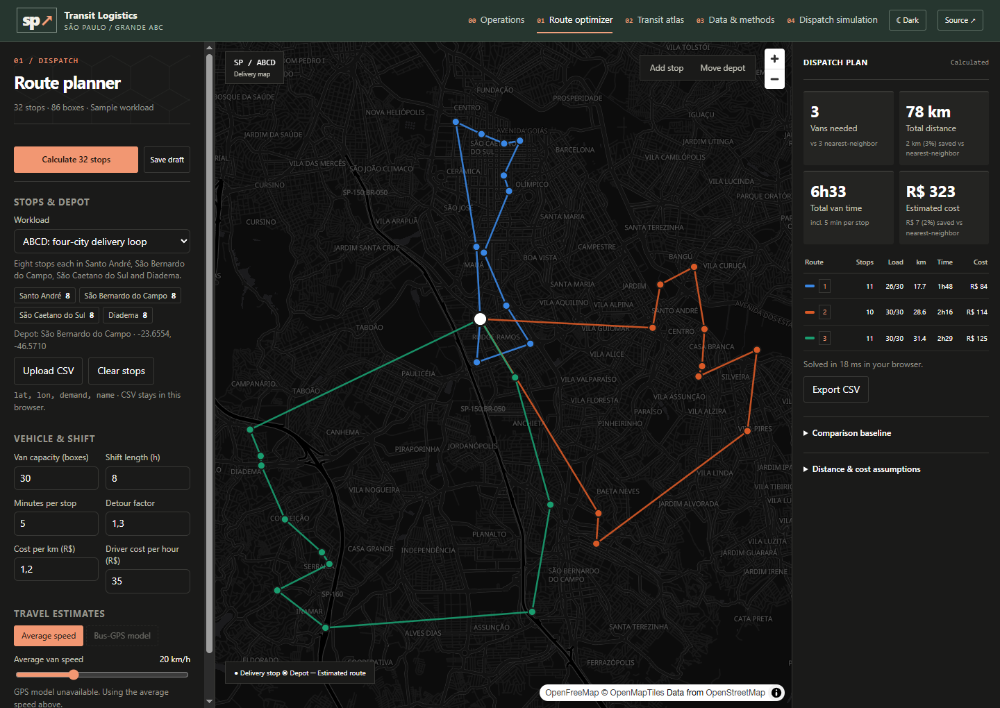
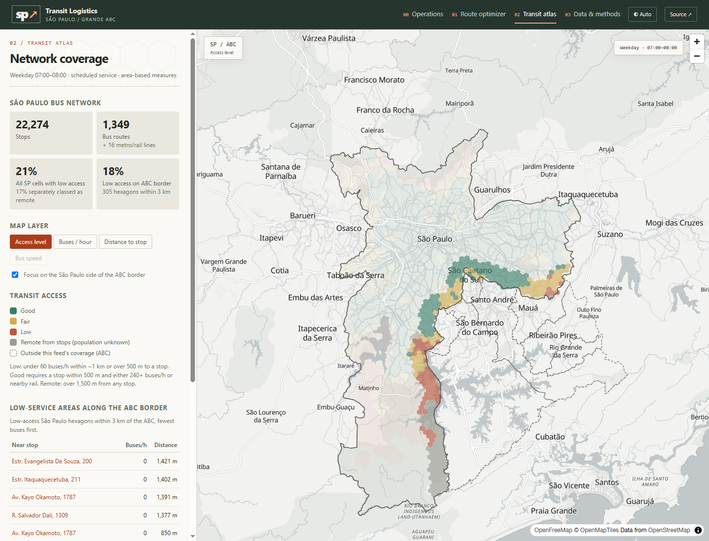
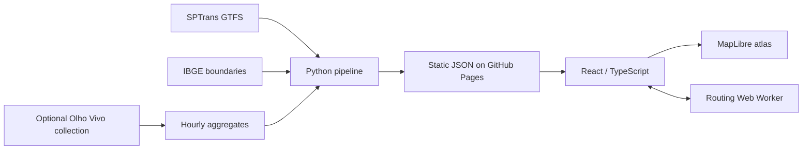

# SP Transit Logistics

A browser-based workspace for delivery planning and transit coverage in São Paulo and the Grande ABC. Select a workload, configure vehicles and shifts, calculate routes, and inspect the stop sequence for each van.

[Open the project](https://arthurgaspar.github.io/sp-transit-logistics/) · [Engineering decisions](#engineering-decisions) · [Routing benchmark](docs/benchmark.md)



## Workspace

The app opens on **Operations**, with the dataset date, network counts, delivery workloads, low-service border areas, and saved work. The figures describe the loaded snapshot; they are not live dispatch or traffic data.

| Workspace | Available actions |
|---|---|
| **Operations** | Select a sample workload, inspect its geographic footprint and demand, open it in the planner, resume a saved draft, or jump to a low-service map cell. |
| **Route optimizer** | Import or place stops, change demand, configure capacity and shift length, calculate a plan, inspect each route, and export its stop sequence. |
| **Transit atlas** | Switch coverage layers, focus on the ABC border, select a cell, and draw the bus routes serving it. |
| **Data & methods** | Check the dataset timestamp, GPS model availability, validation scores, sources, and measurement assumptions. |

The tilted workload preview plots the selected workload’s actual stop locations and depot. Its polygon is the convex hull of the delivery stops, not a calculated route or a service-coverage boundary. The minimum van count shown there assumes 30 boxes per van and considers capacity only.

### Plan a workload

1. In **Operations**, select a workload and choose **Plan selected workload**. Use **New plan / import CSV** to start with an empty stop list and the São Caetano depot.
2. In **Route optimizer**, upload a CSV or use **Add stop** on the map. Use **Move depot** to change the departure point. Expand **Stop manifest** to edit demand or remove stops.
3. Set vehicle capacity, shift length, service time, costs, and travel estimates. Choose **Calculate … stops**.
4. Read the **Dispatch plan** beside the map: van count, distance, total van time, estimated cost, and a comparison with nearest-neighbor dispatch. Select a route number to highlight it and view its stop order; **All routes** restores the full plan.
5. Choose **Export CSV** to download the assigned stop sequences, or **Save draft** to retain the inputs on this device.

Changing the workload or planning inputs clears the previous result. Stops that cannot be served within the capacity or shift constraints are reported separately.



### Import and saved work

CSV input accepts latitude and longitude, with optional demand and name columns:

```csv
lat,lon,demand,name
-23.6229,-46.5548,3,Delivery A
-23.6100,-46.5700,2,Delivery B
```

Headers are optional when columns follow that order. Semicolon-separated files can use decimal commas. Demand defaults to one box when omitted. The planner uses up to **250 stops**.

Files are processed in the browser. **Save draft** stores one draft in browser storage: stops, depot, workload, and fleet settings. Saving again replaces it. Return to **Operations → Saved work** to resume or delete it. Drafts belong to the current browser and site address; they do not sync between devices. Resuming restores the inputs and requires a new calculation.

### Inspect network coverage

The atlas provides access level, scheduled buses per hour, and straight-line distance to a stop. The bus-speed layer is available only when a GPS model has been trained. Select an area to inspect its nearby routes, or open an entry in the Operations border-area table to select and center that cell directly.



## Project context

I’m [Arthur Gaspar](https://github.com/ArthurGaspar), a full-stack developer based in São Caetano do Sul. At Shippify I worked on logistics dashboards and routing systems; at UFABC I worked on Python data pipelines and scientific dashboards. This independent project combines those areas using public transit data and synthetic delivery workloads. It uses no employer or client data.

## Engineering decisions

| Decision | Reason and tradeoff |
|---|---|
| Python pipeline → static JSON | Network analysis and model training happen at build time. Pages can serve the result without an application server, at the cost of snapshot rather than live data. |
| React + TypeScript | Shared data and worker contracts make the pipeline outputs and solver messages explicit. Data-load failures have a retry path. |
| Solver in a Web Worker | Local search leaves the interface responsive. Request IDs prevent an old job from replacing results after the inputs change. |
| Device-local drafts | Stops and settings can be resumed without an account or application server. Drafts are explicitly saved, validated on recovery, and limited to one per browser and site address. |
| Lazy-loaded workspaces | The operations desk does not load the mapping engine or routing worker. Route shapes are requested only after an area is selected. |
| Explicit comparison baseline | Nearest-neighbor dispatch is also a solver starting point. Tests check feasibility and that the driving-time objective does not regress against that baseline. |
| GitHub Actions + Pages | Tests and builds run before deployment; scheduled jobs refresh the feed and collect optional GPS aggregates. Reproduction needs no paid service. |

The Python pipeline prepares the network data and model outputs. The React application reads those snapshots and performs delivery planning locally. GitHub Actions runs the checks, rebuilds the data, and deploys the static application.



## What the measurements mean

The atlas assigns SPTrans stops and trips to H3 resolution 8 cells, then counts distinct scheduled trip departures in each cell and its six neighbors during the 07:00–08:00 weekday peak. A haversine BallTree finds the nearest stop. Rules in `pipeline/network.py` classify access from frequency, distance, and nearby rail.

The headline percentages use **all São Paulo cells**, including cells separately classified as remote. These are area-based measures, not estimates of the number of residents with poor access. Remote cells are excluded from the border gap ranking; their population is unknown.

The supplied feed is not a complete picture of ABC municipal and intermunicipal transit. ABC cells remain unscored. A distance to a stop is a straight line, not a walk along streets.

### Routing

The capacitated vehicle-routing solver uses Clarke–Wright savings with four route-shape parameters, plus a nearest-neighbor start. Each candidate is improved with 2-opt, relocate, and swap moves. The objective is **driving minutes**, not minimum fleet size or minimum monetary cost. Capacity and shift length, including service time, are constraints. Unservable stops are listed explicitly.

Distances use straight-line kilometers multiplied by an editable detour factor. Travel times use either a constant speed or a spatial bus-speed estimate, sampled at each leg’s endpoints and midpoint. There is no road-network routing, turn restriction model, or delivery time window. A shorter estimated route is not evidence of realized operational savings.

Run `npm run benchmark` in `web` after building the data. The [recorded benchmark](docs/benchmark.md) includes the assumptions, baseline, results, and validation checks.

### Scheduled speed versus observed speed

The pipeline tests location and route-design features against scheduled trip speeds using grouped cross-validation. In the checked-in benchmark snapshot, location-only R² is −0.104 and the combined feature set scores 0.143. These tests describe scheduled speeds; they do not measure traffic and do not establish how the timetable’s stop times were generated.

A separate random forest can train on paired Olho Vivo vehicle positions. It is evaluated with spatial GroupKFold against the mean speed for each hour. Bus speed remains an experimental proxy for delivery-van speed, even after scaling. The UI reports whether the model has enough data and keeps that option disabled until it does.

## Run locally

Requires Python 3.11+ and Node 22+.

```sh
python -m venv pipeline/.venv
# Windows PowerShell:
pipeline/.venv/Scripts/Activate.ps1
# macOS / Linux: source pipeline/.venv/bin/activate
pip install -r pipeline/requirements.txt
python pipeline/build.py

cd web
npm ci
npm run dev
```

The data build downloads the GTFS feed once, then uses its local cache. Use `python pipeline/build.py --refresh` to fetch again. Generated JSON and downloaded inputs are ignored by Git.

```sh
# From the repository root:
python -m pytest pipeline/tests -q

# From web/:
npm test
npm run benchmark
npm run build
```

The web tests cover routing feasibility, baseline comparison, spatial travel estimates, CSV import, and safe recovery of saved drafts. The solver regression suite includes a non-metric travel-time case where removing a stop could otherwise leave a route over its shift limit.

## Deployment and optional GPS collection

The existing GitHub Pages workflow deploys pushes to `master` and rebuilds weekly. In the repository’s **Settings → Pages**, select **GitHub Actions** as the source. Pull requests run the build without publishing.

For GPS collection, obtain an [SPTrans developer token](https://www.sptrans.com.br/desenvolvedores/) and set the repository Actions secret `OLHOVIVO_TOKEN`. The collection workflow stores only hourly per-cell aggregates on the `realtime-data` branch. The next site build trains the model once the configured data threshold is met. Scheduled workflow availability and API access determine whether new observations arrive.

## Where I would take it next

1. **A road-network distance matrix.** This would address the planner’s largest approximation before adding more optimization heuristics.
2. **Population-weighted access.** IBGE census counts would distinguish poorly served land from poorly served residents and let the remote class be revisited.
3. **Delivery time windows.** These would make the planner closer to dispatch constraints; they require a new feasibility model and benchmark cases.

## Sources

- SPTrans GTFS, mirrored by [Mobility Database](https://mobilitydatabase.org), feed `mdb-8`.
- [IBGE municipal boundaries](https://servicodados.ibge.gov.br/api/docs/malhas), vendored under `pipeline/data/boundaries`.
- SPTrans Olho Vivo API for optional GPS observations.
- © OpenStreetMap contributors; basemap tiles by [OpenFreeMap](https://openfreemap.org).
