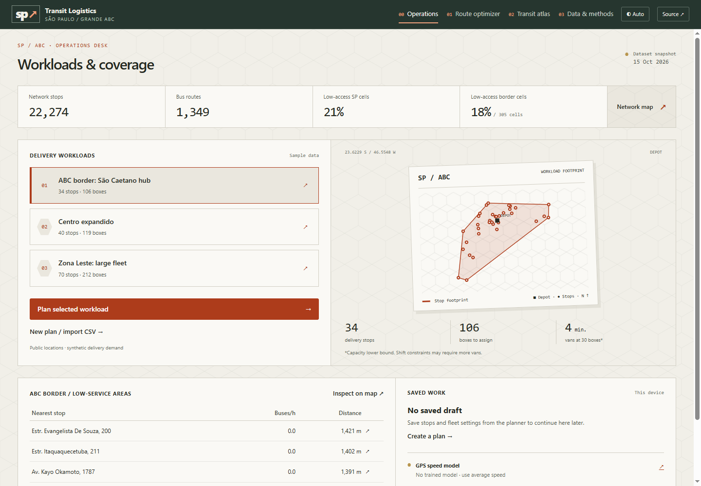
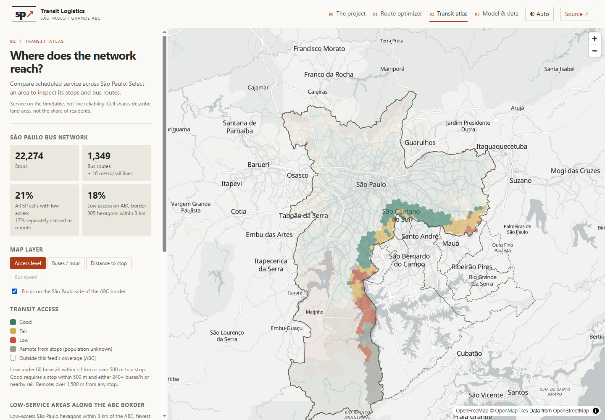
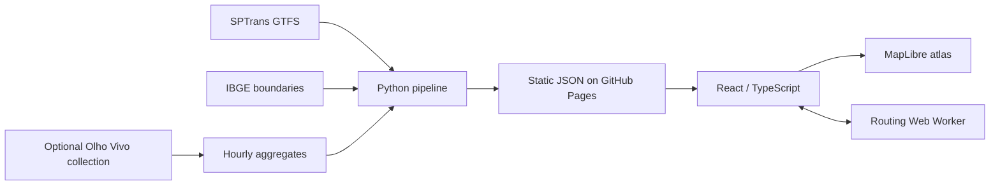
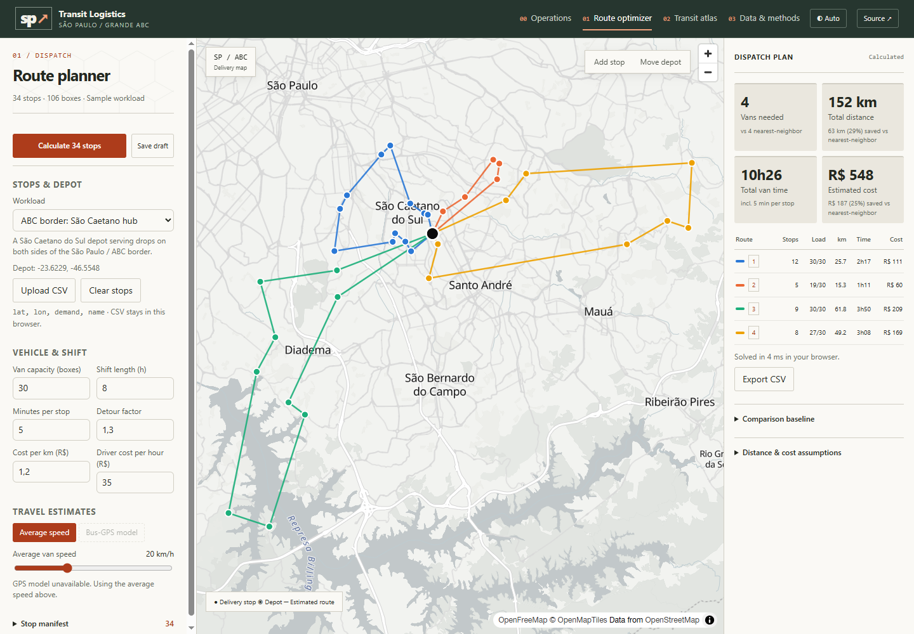

# SP Transit Logistics

An independent project by [Arthur Gaspar](https://github.com/ArthurGaspar): a São Paulo transit atlas and a delivery route planner that runs in the browser.

[Open the project](https://arthurgaspar.github.io/sp-transit-logistics/) · [Engineering decisions](#engineering-decisions) · [Routing benchmark](docs/benchmark.md)



## Why this project

I’m a full-stack developer based in São Caetano do Sul. At Shippify I worked on logistics dashboards and routing systems; at UFABC I worked on Python data pipelines and scientific dashboards. This project brings those areas together around São Paulo and the Grande ABC, using public data and synthetic delivery scenarios. It is independent of my employers and uses no client data.

Two tools answer different questions:

- **Transit atlas:** inspect scheduled peak-hour service, straight-line distance to stops, and the bus routes serving each area. A border filter focuses on the São Paulo side of the ABC.
- **Delivery planner:** select a demo or import delivery points, set capacity and shift constraints, compare with nearest-neighbor dispatch, and export a route sequence. Input files stay in the browser. Save a draft on the device to resume the stops and fleet settings later; results are recalculated. The stop manifest supports demand edits and removals, and selecting a calculated route shows its stop order and highlights it on the map.

The **Operations** desk shows workload footprints, network counts, low-service border areas, and a saved draft. Workloads open directly in the planner; border areas open at their selected map cell. **Data & methods** contains dataset and model diagnostics.



## Engineering decisions

| Decision | Reason and tradeoff |
|---|---|
| Python pipeline → static JSON | Network analysis and model training happen at build time. Pages can serve the result without an application server, at the cost of snapshot rather than live data. |
| React + TypeScript | Shared data and worker contracts make the pipeline outputs and solver messages explicit. Data-load failures have a retry path. |
| Solver in a Web Worker | Local search leaves the interface responsive. Request IDs prevent an old job from replacing results after the inputs change. |
| Lazy-loaded workspaces | The operations desk does not load the mapping engine or routing worker. Route shapes are requested only after an area is selected. |
| Explicit comparison baseline | Nearest-neighbor dispatch is also a solver starting point. Tests check feasibility and that the driving-time objective does not regress against that baseline. |
| GitHub Actions + Pages | Tests and builds run before deployment; scheduled jobs refresh the feed and collect optional GPS aggregates. Reproduction needs no paid service. |

The frontend is a static application, not a demonstration of backend API or database design. The full-stack work here is the data-to-interface workflow, background computation, typed integration, and automated delivery.



## What the measurements mean

The atlas assigns SPTrans stops and trips to H3 resolution 8 cells, then counts distinct scheduled trip departures in each cell and its six neighbors during the 07:00–08:00 weekday peak. A haversine BallTree finds the nearest stop. Rules in `pipeline/network.py` classify access from frequency, distance, and nearby rail.

The headline percentages use **all São Paulo cells**, including cells separately classified as remote. These are area-based measures, not estimates of the number of residents with poor access. Remote cells are excluded from the border gap ranking; their population is unknown.

The supplied feed is not a complete picture of ABC municipal and intermunicipal transit. ABC cells remain unscored. A distance to a stop is a straight line, not a walk along streets.

### Routing

The capacitated vehicle-routing solver uses Clarke–Wright savings with four route-shape parameters, plus a nearest-neighbor start. Each candidate is improved with 2-opt, relocate, and swap moves. The objective is **driving minutes**, not minimum fleet size or minimum monetary cost. Capacity and shift length, including service time, are constraints. Unservable stops are listed explicitly.

Distances use straight-line kilometers multiplied by an editable detour factor. Travel times use either a constant speed or a spatial bus-speed estimate, sampled at each leg’s endpoints and midpoint. There is no road-network routing, turn restriction model, or delivery time window. A shorter estimated route is not evidence of realized operational savings.

Run `npm run benchmark` in `web` after building the data. The [recorded benchmark](docs/benchmark.md) includes the assumptions, baseline, results, and validation checks.



### Scheduled speed versus observed speed

The pipeline tests location and route-design features against scheduled trip speeds using grouped cross-validation. In the checked-in benchmark snapshot, location-only R² is −0.104 and the combined feature set scores 0.143. These tests describe scheduled speeds; they do not measure traffic and do not establish how the timetable’s stop times were generated.

A separate random forest can train on paired Olho Vivo vehicle positions. It is evaluated with spatial GroupKFold against the mean speed for each hour. Bus speed remains an experimental proxy for delivery-van speed, even after scaling. The UI reports whether the model has enough data and keeps that option disabled until it does.

## Run locally

Requires Python 3.11+ and Node 22+.

```sh
python -m venv pipeline/.venv
# Windows PowerShell:
pipeline/.venv/Scripts/Activate.ps1
# macOS / Linux: source pipeline/.venv/bin/activate
pip install -r pipeline/requirements.txt
python pipeline/build.py

cd web
npm ci
npm run dev
```

The data build downloads the GTFS feed once, then uses its local cache. Use `python pipeline/build.py --refresh` to fetch again. Generated JSON and downloaded inputs are ignored by Git.

```sh
# From the repository root:
python -m pytest pipeline/tests -q

# From web/:
npm test
npm run benchmark
npm run build
```

The web tests cover routing feasibility, baseline comparison, spatial travel estimates, CSV import, and safe recovery of saved drafts. The solver regression suite includes a non-metric travel-time case where removing a stop could otherwise leave a route over its shift limit.

## Deployment and optional GPS collection

The existing GitHub Pages workflow deploys pushes to `master` and rebuilds weekly. In the repository’s **Settings → Pages**, select **GitHub Actions** as the source. Pull requests run the build without publishing.

For GPS collection, obtain an [SPTrans developer token](https://www.sptrans.com.br/desenvolvedores/) and set the repository Actions secret `OLHOVIVO_TOKEN`. The collection workflow stores only hourly per-cell aggregates on the `realtime-data` branch. The next site build trains the model once the configured data threshold is met. Scheduled workflow availability and API access determine whether new observations arrive.

## Where I would take it next

1. **A road-network distance matrix.** This would address the planner’s largest approximation before adding more optimization heuristics.
2. **Population-weighted access.** IBGE census counts would distinguish poorly served land from poorly served residents and let the remote class be revisited.
3. **Delivery time windows.** These would make the planner closer to dispatch constraints; they require a new feasibility model and benchmark cases.

## Sources

- SPTrans GTFS, mirrored by [Mobility Database](https://mobilitydatabase.org), feed `mdb-8`.
- [IBGE municipal boundaries](https://servicodados.ibge.gov.br/api/docs/malhas), vendored under `pipeline/data/boundaries`.
- SPTrans Olho Vivo API for optional GPS observations.
- © OpenStreetMap contributors; basemap tiles by [OpenFreeMap](https://openfreemap.org).
