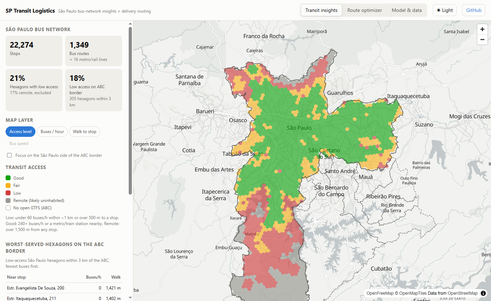
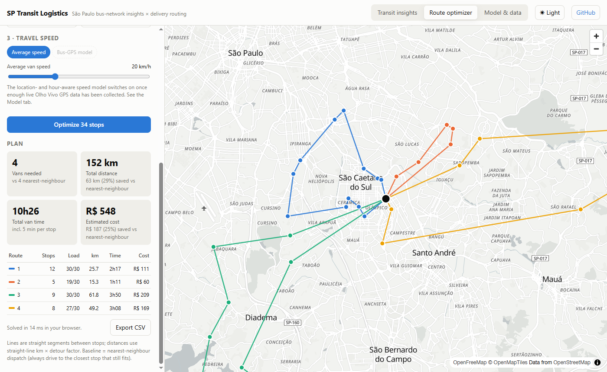
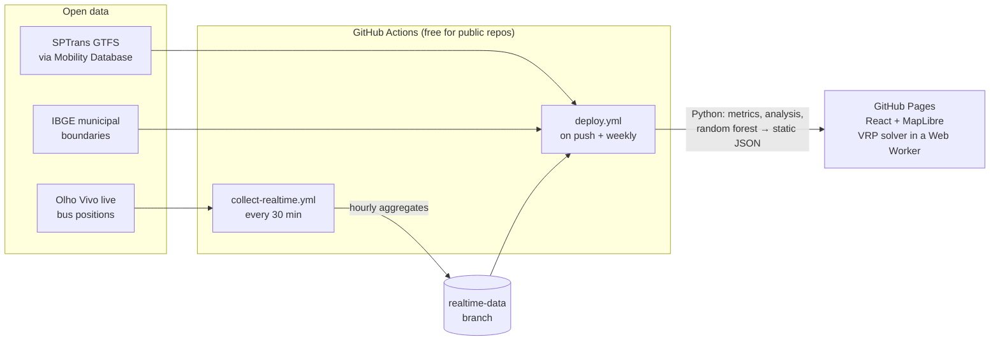

# SP Transit Logistics

São Paulo bus-network analysis and a delivery route optimizer, served as a static site.

**Live demo:** https://arthurgaspar.github.io/sp-transit-logistics/



Three views, built on open data:

- **Transit insights.** Every São Paulo hexagon (H3 resolution 8, ~0.74 km²) scored by scheduled bus frequency and walking distance to a stop. There's a focus mode for the São Paulo side of the **Grande ABC** border and a ranked list of its worst-served areas. Click a hexagon to see and draw the bus routes serving it.
- **Route optimizer.** Upload a CSV of delivery points (or use a demo scenario) and get a capacitated vehicle-routing plan: fleet size, km, hours and cost per van, compared with a nearest-neighbor dispatch baseline. It's solved in a Web Worker in milliseconds, and files never leave the browser.
- **Model & data.** A documented analysis of what the official timetable can and can't tell you about traffic, plus the live-GPS speed model card.



## Key findings

| Question | Result |
|---|---|
| Bus stops / routes analyzed | 22,274 stops, 1,349 bus routes + 16 metro/rail lines |
| São Paulo hexagons with low transit access* | 21% (plus 17% classed as remote / likely uninhabited) |
| Low access within 3 km of the ABC border | 18% of 305 hexagons |
| Route optimizer vs nearest-neighbor dispatch | **11-29% fewer km** on the demo scenarios, same fleet size |
| Can the GTFS timetable predict where buses are slow? | **No.** Location features give a cross-validated R² of −0.10 |

\*Under 60 scheduled buses/hour within ~1 km at the 7-8 am peak, or over 500 m to a stop.

### Why the speed model uses GPS instead of the timetable

The SPTrans timetable can't tell where buses run slowly. Stop-to-stop times don't correlate with stop-to-stop distance (median r = −0.07), so they are interpolated rather than measured, and trip speed doesn't correlate with distance from the center (r = 0.002). The pipeline recomputes these checks on every build. The speed model trains on GPS positions from the SPTrans Olho Vivo API instead, collected by a scheduled GitHub Action. See [Enable the live speed model](#enable-the-live-speed-model).

## Architecture



No servers, databases or paid APIs. The Python pipeline precomputes everything into static JSON (~450 KB gzipped, with route shapes loaded only when needed), and the browser does the interactive work. The whole site transfers ~1.1 MB gzipped.

| Layer | Stack |
|---|---|
| Data pipeline | Python, pandas, H3, Shapely, scikit-learn, SciPy, pytest |
| Web app | React 19, TypeScript, Vite, MapLibre GL, h3-js, Vitest |
| Basemap | OpenStreetMap data, OpenFreeMap tiles (free, no key) |
| CI/CD | GitHub Actions → GitHub Pages |

## How it works

**Access metrics** (`pipeline/network.py`). Each stop is assigned to an H3 cell. For every cell, the pipeline sums the peak-hour departures (`frequencies.txt`) of all distinct trips stopping in the cell or its six neighbors, counts routes, and finds the nearest stop with a haversine BallTree. Thresholds sit near the 20th percentile and the median of urban hexagons. Without population data, hexagons more than 1.5 km from any stop are treated as remote (reservoirs, Atlantic forest) and kept out of gap rankings.

**Route optimizer** (`web/src/lib/vrp.ts`). Capacitated VRP with a shift-length limit and per-stop service time. It builds candidate plans with Clarke-Wright savings (four route-shape λ values) and a nearest-neighbor plan, improves each with 2-opt, relocate and swap local search, and keeps the best. Since the nearest-neighbor plan is one of the starts, the result is never worse than the baseline; a unit test enforces this. Travel time = straight-line km × detour factor ÷ speed, where speed is either a constant or the live model's prediction for each area and hour.

**Live speed model** (`pipeline/collect_realtime.py`, `pipeline/speed_model.py`). Two snapshots of every bus position, 75 s apart, become per-vehicle speeds, aggregated per hexagon and hour. Only aggregates are stored. A random forest learns speed from hour (cyclical encoding), weekday/weekend, location and network density. It's validated with spatial GroupKFold over ~36 km² blocks against a strong baseline (the city-wide mean speed for that hour). ABC hexagons, which have no SPTrans GPS, take the mean of their nearest São Paulo neighbors.

## Run locally

Needs Python 3.11+ and Node 22+.

```bash
# 1. Build the data (~15 s; downloads ~14 MB of GTFS once)
python -m venv pipeline/.venv
pipeline/.venv/Scripts/activate        # Windows; use `source pipeline/.venv/bin/activate` on macOS/Linux
pip install -r pipeline/requirements.txt
python pipeline/build.py               # add --refresh to re-download the feed

# 2. Run the app
cd web
npm install
npm run dev
```

Tests: `python -m pytest pipeline/tests` and `cd web && npm test`.

## Deploy

1. Push to a **public** GitHub repository named `sp-transit-logistics`.
2. Under **Settings → Pages**, set **Source** to **GitHub Actions**.
3. The `Build and deploy` workflow runs on every push to `master` and every Monday with a fresh GTFS feed.

## Enable the live speed model

1. Create a free developer account at <https://www.sptrans.com.br/desenvolvedores/> and create an application to get a token.
2. In the repository, open **Settings → Secrets and variables → Actions** and add a secret named `OLHOVIVO_TOKEN`.
3. The `Collect live bus speeds` workflow then runs every 30 minutes and commits hourly aggregates to the `realtime-data` branch. After at least 3 days of data, the next deploy trains the model, and the **Bus speed** map layer and **Bus-GPS model** optimizer mode switch on.

GitHub may pause scheduled workflows in repositories with no activity for 60 days; re-enable it from the Actions tab if that happens.

## Limitations and next steps

- **ABC coverage.** The ABC municipalities and EMTU publish no open GTFS, so access is scored on the São Paulo side only.
- **Population.** Adding IBGE census population per hexagon would turn "low access" into "people with low access".
- **Road distances.** Routes use straight-line distance × detour factor. A precomputed OSM road graph could give real road distances while staying static.
- **Optimizer features.** Time windows, multiple depots and a fixed cost per van are natural extensions.

## Data sources and licenses

- SPTrans GTFS, mirrored by [Mobility Database](https://mobilitydatabase.org) (feed `mdb-8`)
- [IBGE](https://servicodados.ibge.gov.br/api/docs/malhas) municipal boundaries, vendored in `pipeline/data/boundaries` because the IBGE server omits its intermediate TLS certificate
- SPTrans Olho Vivo API
- © OpenStreetMap contributors; tiles by [OpenFreeMap](https://openfreemap.org)
