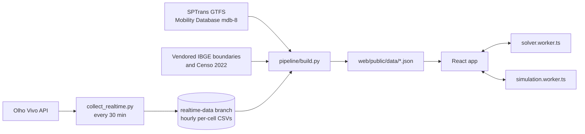

# Architecture

The project is a static site with an offline data build. Python prepares every dataset ahead of time. The browser does all interactive computation. No server holds application state.



## Pipeline (`pipeline/`)

`build.py` runs five stages and is the only module that writes outputs.

| Stage | Modules | What happens |
|---|---|---|
| 1. Fetch inputs | `fetch.py`, `gtfs.py`, `population.py` | Downloads the GTFS zip into `pipeline/cache/` unless it's already cached or `--refresh` is passed. Reads vendored boundaries from `pipeline/data/boundaries/`. Loads and validates the census snapshot. |
| 2. Access metrics | `network.py` | Builds H3 resolution-8 cells covering São Paulo and the Grande ABC. For each cell, counts distinct peak-hour (07:00–08:00 weekday) trips across the cell and its six neighbors, finds the nearest stop with a haversine BallTree, and classifies access. |
| 3. Schedule signal | `schedule_signal.py` | Tests how well location and route-design features explain scheduled trip speeds, using grouped cross-validation. This is descriptive only. |
| 4. Speed model | `speed_model.py` | If enough Olho Vivo aggregates exist, trains a random forest validated with spatial `GroupKFold`, then predicts a weekday speed grid of cells × 24 hours. If not, it returns a `waiting_for_data` card. |
| 5. Write outputs | `build.py`, `workloads.py` | Simplifies route shapes and boundaries, samples the demo delivery scenarios, and writes the JSON files described in [data contracts](data-contracts.md). |

### Access classification

`network.classify_access` applies these rules in order. The thresholds are module constants in `network.py`, and they're also copied into `meta.json` so the UI can display them.

Two conditions feed the rules. A cell meets the *good condition* when peak buses ≥ `GOOD_BUSES_PER_HOUR` or it has rail. It meets the *low condition* when peak buses < `LOW_BUSES_PER_HOUR` or its nearest stop is beyond `MAX_WALK_TO_STOP_M`.

1. A cell is **remote** if its nearest stop is beyond `REMOTE_STOP_M` and it has no rail. This rule overrides the others.
2. A cell is **good** if it meets the good condition and not the low condition.
3. A cell is **low** if it meets the low condition and has no rail.
4. Every other cell is **fair**. That includes rail cells that meet the low condition.

Cells outside São Paulo are `no_data`, because the SPTrans feed doesn't describe ABC municipal transit. All shares are shares of cells, not of residents.

### Demo scenarios

`_demo_scenarios` samples delivery points with a seeded RNG (`config.RANDOM_SEED`):

- **São Paulo scenarios** use real SPTrans stop locations, spread at a minimum spacing.
- **ABCD scenarios** use synthetic points near neighborhood anchors (`workloads.ANCHORS`), rejection-sampled inside the IBGE municipal polygon. `interleave` orders them round-robin by city, so the simulator's first 24 stops cover every municipality.
- Every depot is checked against its municipality polygon, and demand is a synthetic integer from 1 to 5.

### Realtime collection

`collect_realtime.py` takes two snapshots of every bus position about 75 s apart. It turns each vehicle's displacement into a speed and aggregates the speeds per H3 cell and local hour, storing `n`, `sum_kmh` and `sum_kmh_sq`. It appends to `speeds-YYYY-MM.csv` in `REALTIME_DIR`. Raw positions are never stored. CI keeps these CSVs on the orphan `realtime-data` branch and extracts them into `pipeline/realtime/` before each build.

## Web app (`web/src/`)

```
main.tsx           mounts <App/>
App.tsx            hash router, top bar, theme toggle, lazy view loading
data.ts            JSON types + cached load<T>()
theme.ts           system/light/dark preference (localStorage "sptl-theme")
views/
  Overview.tsx     Operations desk: workloads, border gaps, saved draft (eager)
  Optimizer.tsx    Route planner: stops, depot, params, solver worker, CSV export
  Insights.tsx     Transit atlas: MapLibre layers, municipality focus, route drawing
  Model.tsx        Data & methods: dataset metadata, validation, census table
  Simulation.tsx   Dispatch simulation: settings, comparison, replay, JSON export
components/        MapView (MapLibre wrapper), WorkloadPlot, charts, ui primitives
lib/               pure logic, unit-tested (*.test.ts beside each module)
```

### Navigation and deep links

The URL hash selects the view. Query parameters after the hash pass context between views, and `workspaceQuery()` reads them.

| Link | Effect |
|---|---|
| `#optimizer?scenario=<id>` | Opens the planner with a sample workload. |
| `#optimizer?empty=1` | Opens an empty plan with a movable depot. |
| `#optimizer?draft=1` | Restores the saved draft. |
| `#insights?border=1` | Atlas filtered to the São Paulo side of the ABC border. |
| `#insights?cell=<h3>&border=1` | Atlas centered on one cell. |

`<main>` is keyed by the full hash, so changing the hash remounts the view and its state resets cleanly.

### Lazy loading

Overview is the only view that loads eagerly. It reads just `meta.json`, `scenarios.json` and the draft, never MapLibre or a worker. The atlas loads `cell-routes.json` and `routes.json` only after a cell is selected.

### Static solver (`lib/vrp.ts`, `lib/travel.ts`)

- **Problem.** A capacitated VRP with a per-route time limit. Matrices are indexed with the depot at 0. `demand`, `capacity`, `maxRouteMinutes` and `serviceMinutes` define feasibility.
- **Objective.** Total driving minutes. It isn't fleet size or monetary cost; cost is computed afterwards for display.
- **Search.** `servable()` first removes stops that can't fit even alone. Clarke–Wright savings then runs with four λ shape parameters (`SAVINGS_LAMBDAS`), plus a nearest-neighbor start. Each start is improved by 2-opt, relocate and swap moves within an equal share of the time budget, and the best result is kept.
- **Baseline.** `nearestNeighborPlan` is both the comparison shown in the UI and one of the starting points. That's what guarantees the result never regresses below it.
- **Travel model.** `buildMatrices` returns symmetric `km` (haversine × circuity) and `minutes` matrices. `minutes` uses the mean pace (1/speed) at the two endpoints and the midpoint. `speedAt` is either `constantSpeed(kmh)`, or `cellSpeed(...)`, which looks up the trained bus-speed grid, searches up to three H3 rings outward, scales by a vehicle factor, and falls back to the constant speed.

### Dispatch simulation (`lib/simulation.ts`)

`simulate(workload, settings, policy)` is an event-driven, deterministic simulation of vans executing routes while events arrive: order releases, a traffic multiplier, a service delay, and a vehicle outage with recovery. The three policies are defined by `POLICIES`:

- **`fixed`** keeps the solver's initial order.
- **`nearest`** keeps the nearest-neighbor order.
- **`adaptive`** starts from the fixed routes and reorders an affected van's unvisited suffix after a disruption, but only if the projected cost improves after a coordination overhead.

`compareStrategies` runs every policy, plus a sensitivity sweep over disruption severity, and returns the full event traces. The scoring formula and the recorded experiment are in [dispatch-simulation.md](dispatch-simulation.md).

### Workers

Both workers follow the same contract:

1. The view creates the worker with `new Worker(new URL("../lib/x.worker.ts", import.meta.url), { type: "module" })`.
2. Every request carries `requestId: ++revision.current`.
3. `onmessage` ignores any response whose `requestId !== revision.current`, so a slow, stale job can't overwrite results computed from newer inputs.
4. The simulation worker returns `{ requestId, error }` on failure rather than throwing.

`SolveRequest` and `SolveResponse` are exported from `solver.worker.ts`, and `SimulationRequest` from `simulation.worker.ts`.

### Browser storage

| Key | Owner | Contents |
|---|---|---|
| `sptl-draft` | `lib/draft.ts` | A single saved plan: version, timestamp, scenario ID, depot, up to 250 points, and `PlanParams`. |
| `sptl-theme` | `theme.ts` | `system`, `light` or `dark`. |

Every storage access is wrapped in try/catch. `readDraft()` validates each field and range, and returns `null` instead of throwing.

## CI and deployment

`.github/workflows/deploy.yml` runs on pushes to `master`, on pull requests, weekly (Monday 09:00 UTC) and on manual dispatch. It tests the pipeline, pulls realtime aggregates if the branch exists, rebuilds data with `--refresh`, then runs the web tests, both benchmarks and the production build. Every trigger except pull requests then publishes `web/dist` to GitHub Pages. `vite.config.ts` sets `base: "./"`, so the same build works under `/<repo>/` and locally.

`.github/workflows/collect-realtime.yml` runs every 30 minutes and does nothing unless the `OLHOVIVO_TOKEN` secret is set.
