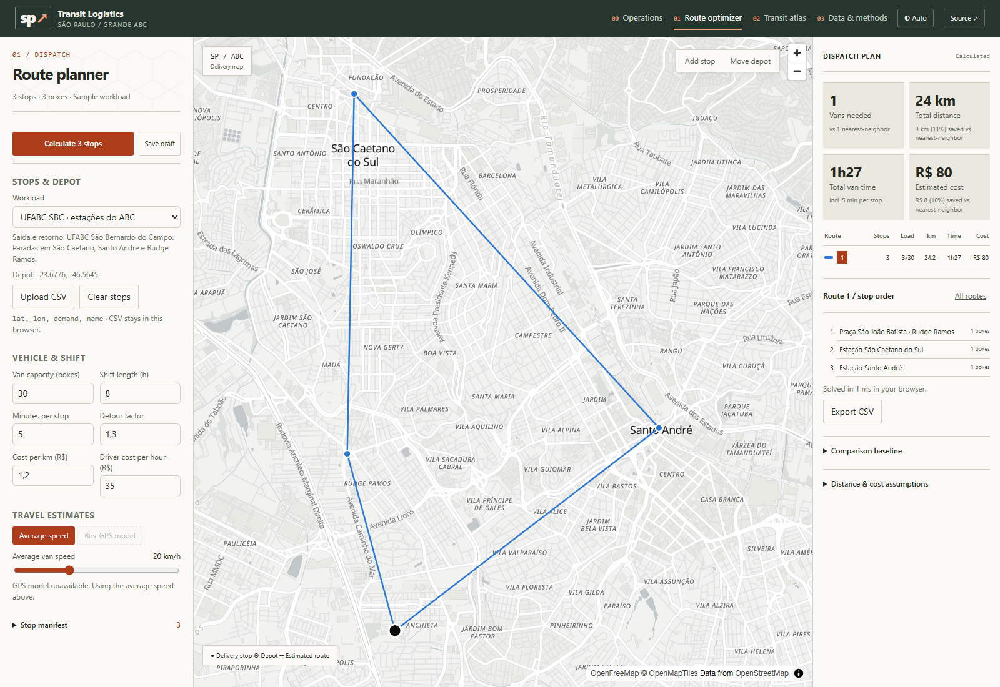

# UFABC São Bernardo / ABC route example

The screenshot uses UFABC’s São Bernardo do Campo campus as the depot, with three nearby destinations. The calculated stop order is:

1. Praça São João Batista, Rudge Ramos.
2. Estação São Caetano do Sul–Prefeito Walter Braido.
3. Estação Prefeito Celso Daniel–Santo André.
4. Return to UFABC São Bernardo.

The [workload JSON](ufabc-abc-workload.json) records the exact inputs used for this screenshot. It was supplied as a temporary sample workload during capture; it does not add a built-in scenario to the application.

## Inputs and interpretation

Each destination has a synthetic demand of one box. Settings: capacity 30 boxes, 8-hour shift, 5 minutes per stop, average speed 20 km/h, detour factor 1.3, R$1.20/km, and R$35/hour. The result is one route, approximately 24.2 km, 1h27 total van time, and R$80 estimated cost.

This is the app’s closed delivery loop, including the return to the depot. It is not a one-way commuter itinerary. Lines connect locations directly; kilometers and travel times are estimates rather than road-network directions or live traffic measurements.

Coordinates represent approximate campus, station, and square locations, not verified vehicle entrances:

| Location | Latitude | Longitude | Source |
|---|---:|---:|---|
| UFABC São Bernardo | -23.67763 | -46.56445 | [Mapped campus](https://mapcarta.com/pt/W290653696); [official campus address](https://www.ufabc.edu.br/a-ufabc/campi/sao-bernardo-do-campo) |
| São Caetano station | -23.61006 | -46.57006 | [Mapped station](https://mapcarta.com/pt/N4580231040) |
| Santo André station | -23.65212 | -46.52820 | [Mapped railway stop](https://mapcarta.com/N2278811011) |
| Praça São João Batista | -23.65538 | -46.57101 | [Square address and coordinates](https://www.ruacep.com.br/sp/sao-bernardo-do-campo/rudge-ramos/09626140-praca-sao-joao-batista/) |
